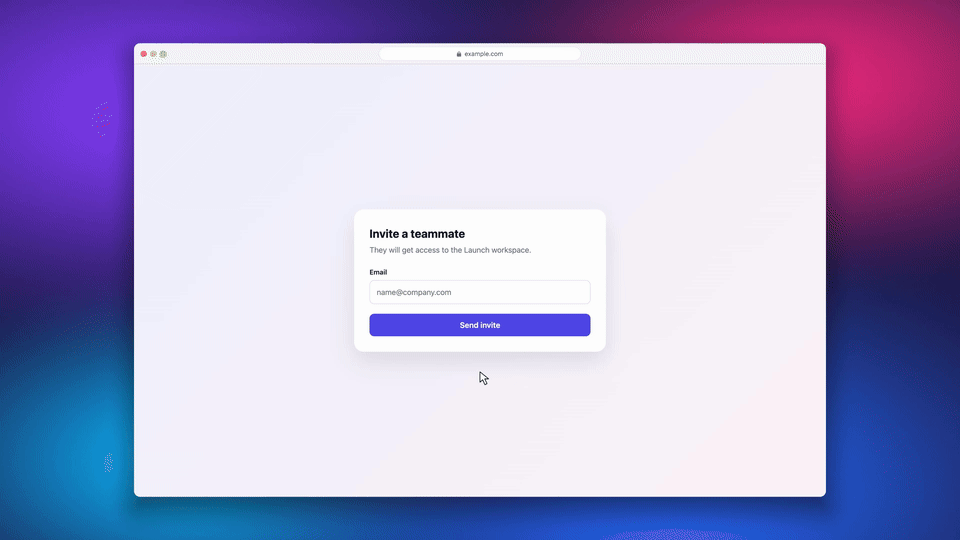

# CueTake

[](https://skills.sh/levyxdev/cuetake) [](https://www.npmjs.com/package/cuetake)

**Script the flow. Keep the take.**

Built entirely for AI agents, CueTake turns browser interactions into sharp product demo videos with a precise cursor and continuous camera moves. Give an agent a scenario, then capture, render, and verify the result locally.



- Retina tab capture at 30 or 60 fps and a 2× pixel scale, headless by default.
- An automatic camera in the style of Screen Studio: it arrives just before each click, field and drag, follows the cursor on a spring, and ends on the wide shot.
- The page framed in a browser or macOS window over fluted glass lit in the product's brand color, at any output size; backgrounds, chrome, cursors and click effects are shaders or drawing code the agent can write.
- A Cursor drawn at Render time in the shape the page asks for, pressing on each click, so a Take can be restyled without recording again.
- Keyboard shortcuts shown as keycaps, so a demo of a command palette or an editor teaches the keys it presses.
- Styling chosen in conversation: the agent shows Previews of candidate Looks side by side in about a second, and the Look you pick is saved for later Takes.
- Rendering in Chromium with WebGL and WebCodecs: no FFmpeg, 4K60 by default.
- A separate folder for every Take: Source, Timeline, Edit, Final MP4, and verification.

## For AI agents

If a user hands you this repository to set up CueTake:

1. Install the skill with `npx skills add levyxdev/cuetake`. In Claude Code you can instead run `/plugin marketplace add levyxdev/cuetake`, then `/plugin install cuetake`.
2. The skill's `scripts/cuetake` runs the pinned [`cuetake`](https://www.npmjs.com/package/cuetake) package with `npx`, so nothing else needs installing besides Node. To run a source checkout instead, export `CUETAKE_BIN="node /absolute/path/to/cuetake/src/cli.js"`.
3. Follow the skill's [setup guide](skills/cuetake/setup.md): run `scripts/cuetake doctor`, and install Node or the browser only after the user agrees to the option they pick.
4. Write a Scenario for the user's product with the [scenario API](skills/cuetake/scenarios.md), record it, and review the frames with `scripts/cuetake frame`.

## Run from source

Requirements: Bun for development (users run the CLI on Node 20.10+) and the Chromium build CueTake's Playwright drives. Verified on macOS, headless and headed.

```sh
bun install --frozen-lockfile
bun run doctor
# Only if doctor reports Chromium missing (about 150 MB):
bun src/cli.js install-browser

bun src/cli.js record examples/basic.mjs --out ./recordings/first-take
```

The example opens `https://example.com` only for a stable HTTPS origin, then replaces the page with a small invite form, types an email and sends it, so it works without a local application server. For your own product, write a scenario using the [scenario API](skills/cuetake/scenarios.md).

Playwright is a local package dependency. Browser binaries use Playwright's normal OS cache. CueTake does not install global packages or start your application server.

## Commands

```sh
bun src/cli.js doctor
bun src/cli.js install-browser
bun src/cli.js uninstall --dry-run
bun src/cli.js record ./my-scenario.mjs --out ./recordings/my-take [--headed]
bun src/cli.js render ./recordings/my-take
bun src/cli.js verify ./recordings/my-take
bun src/cli.js frame ./recordings/my-take 2.5
bun src/cli.js login product-demo https://your-app.example/login
```

`record` completes capture → render → verification and refuses an existing output folder. `render` uses the saved Source, Timeline and Edit; it replaces the final video only after encoding succeeds. Copy a Take folder to keep several edits.

A successful command is a technical check, not an editorial approval. Watch the result before publishing.

## How it works

Playwright drives an isolated Chromium tab. Chromium captures the tab at device-pixel resolution using `getDisplayMedia`; a VP9 `MediaRecorder` saves the source. An in-page probe records the pointer path, clicks, drags, typing and shortcuts into the Timeline. Render then composes the camera path in a headless Chromium page with WebGL and encodes H.264 with WebCodecs; see [ADR 0001](docs/adr/0001-render-in-browser-with-webgl-and-webcodecs.md).

Source capture is variable frame rate. Static scenes may drop to approximately one captured frame per second, and busy scenes can drop frames. A 60 fps output does not imply 60 unique source frames every second. Capture callback statistics and output metadata are retained in each take. No motion interpolation is used. Without a GPU, Chromium rasterizes and encodes on the CPU, so a busy page at resolution scale 2 can get only a few frames per second: `record` then defaults to scale 1, and `verify` warns when the page got too few animation frames during Capture.

## Current scope

The supported workflow is a short, same-document browser demo, including SPA interactions. A full page navigation or reload destroys the in-page recorder; record those as separate takes. Page audio and desktop/window capture are outside this workflow; a Narration voiced by a separate speech tool is mixed in at Render, with Subtitles ([narration](skills/cuetake/narration.md)). Input inside cross-origin iframes is not seen by the Timeline probe, so the cursor and camera do not follow it there. Headless Chromium renders the generic `monospace` family as Courier rather than Menlo; record with `--headed` when a page relies on it. Browser automation and captured data stay local; the visited website still receives normal browser requests.

The bundled [agent skill](skills/cuetake/SKILL.md) teaches planning and operation; site-specific scenarios stay in your application project. See [distribution](docs/distribution.md) and [login](skills/cuetake/authentication.md).

## Development

```sh
bun test tests/pipeline.test.js
# With Playwright Chromium installed:
bun test tests/browser.test.js
```

`pipeline.test.js` covers configuration and camera math; `browser.test.js` covers the probe, Auth profiles, and Render geometry, the Cursor's shape, press and fade, and sparks at a 2× capture scale. No build step is required. Do not commit recordings, browser profiles, credentials, or product-specific scenarios into this generic tool repository.
